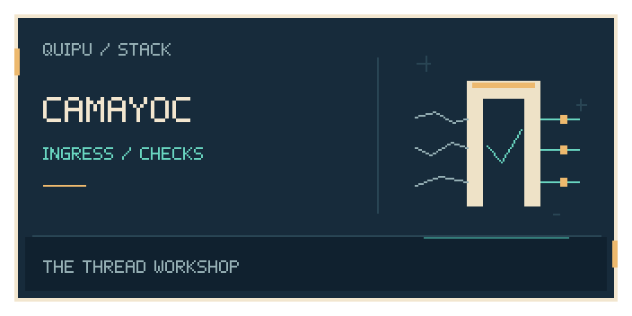

<p align="center"></p>

<h1 align="center">camayoc</h1>

<p align="center">
  <em>🪢 Memory your agents can trust: every fact says how it was learned.</em>
</p>

<p align="center">
  <a href="LICENSE"></a>
  <a href="https://github.com/intigraph/camayoc/actions/workflows/ci.yml"></a>
  <a href="https://github.com/intigraph/tambo"></a>
</p>

**Camayoc gives AI agents a memory that is checked on the way in, for teams
whose agents keep re-deciding what an earlier session settled. It comes as a
CLI (`cy`), two MCP servers and a Claude Code plugin.** It defines what a
decision, a directive, a handoff or a deployment means in a
[Quipu](https://github.com/intigraph/quipu) store, and Quipu then refuses any
record that does not fit, including one that does not say whether it was
observed, declared or inferred.

The *quipucamayoc* was the Inca official who kept the quipus and certified what
was read back out of them.

<p align="center"></p>

## Why you would want it

- **Stop re-deciding.** An agent asks what was decided about a service, a
  repository or a person before it acts, and gets the ruling, who made it and
  why.
- **Know how each fact was learned.** Every record is observed, declared or
  inferred. What an agent concluded never overrides what a person said.
- **Refuse bad records at the door.** A decision with no source, a
  verification with nothing that could prove it wrong, and an event of an
  unknown type are all refused or quarantined, with the reason.
- **Bring delivery history in.** Deployments, changes and reviews from GitHub,
  Forgejo, Ansible and Terraform land in the same store as the decisions
  behind them.

The full case, and how Camayoc compares with the alternatives:
[Why Camayoc](https://intigraph.github.io/camayoc/why-camayoc.html).

## Install

The memory CLI needs Python 3.10 or newer and
[uv](https://docs.astral.sh/uv/):

```sh
uv tool install git+https://github.com/intigraph/camayoc
cy --version
```

This installs `cy` and `camayoc`, which are the same command. The vocabulary,
shapes, queries and ingress adapters come as a checked source release:

```sh
curl -fsSL https://raw.githubusercontent.com/intigraph/camayoc/main/install.sh | sh
```

That needs `curl` and Linux or macOS. It downloads the latest release, checks
it against the published checksum and unpacks it into
`~/.local/share/camayoc/TAG`. The
[installation reference](docs/installation-reference.md) covers pinned
releases, another prefix and removal.

## First success in three commands

This needs `git`, `curl`, Python 3 and a Quipu server binary. With
[Quipu installed](https://github.com/intigraph/quipu#install), run this from
an empty directory:

```sh
git clone -q --depth 1 https://github.com/intigraph/camayoc
QUIPU_SERVER=http://127.0.0.1:3030 bash camayoc/scripts/bootstrap.sh > bootstrap.log 2>&1
grep -E '^(ontology|gate: PROVEN — an untagged|camayoc:)' bootstrap.log
```

You should see:

```text
ontology: loaded (core.ttl)
gate: PROVEN — an untagged Decision refused, as it must be.
camayoc: governed memory ready. Query first; record at the moment; tag honestly.
```

The bootstrap started a Quipu server on a store in `.quipu/`, loaded the
vocabulary, the shapes and the stored queries, and then tried to write a
decision that does not say how it was learned. The store refused it. Every
other guarantee rests on that refusal. On Linux x86_64 the bootstrap downloads
a Quipu release when none is installed. Stop the server with
`kill "$(cat .quipu/server.pid)"`; the full log is in `bootstrap.log`.

## On your own data

`cy` records and recalls five kinds of memory: a decision, a directive, a
preference, a handoff and a reference to where a system lives.

| you want to | run |
|---|---|
| Read the agent primer and this machine's state | `cy prime` |
| Ask what was decided about something | `cy recall decision --about orders-service` |
| Record a ruling when it is made | `cy record decision --chose "Use Postgres." --by alex --about orders-service --topic database-choice` |
| See every field a record takes | `cy record decision --help` |
| Read your last handoff | `cy recall handoff --agent my-agent` |
| Replay records made while Quipu was unreachable | `cy flush` |
| List the questions the vocabulary can answer | `python3 scripts/competency.py --list` |

`cy` writes to the server in `QUIPU_SERVER`. A record names people, systems
and topics that are already in the store, and `cy` refuses a name it cannot
find and suggests the nearest ones. A new record on the same subject and topic
supersedes the old one, which stays in the history.

`cy` needs a store that has the agent-memory shapes and the entities your
records name. The bootstrap above does not load them: see
[the agent-memory CLI](docs/installation-reference.md#agent-memory-cli-camayoc-alias-cy)
for what the store needs.

## Wire it into your agent

In Claude Code, install the plugin:

```text
/plugin marketplace add intigraph/camayoc
/plugin install camayoc@camayoc
```

The plugin brings four things:

- **A skill** that tells the agent to query before deciding and to record a
  ruling when it is made.
- **A session-start hook** that reports whether memory is reachable. A store
  it could not reach is reported as "could not look", never as "nothing
  exists".
- **The `camayoc-memory` MCP server,** with one `record_` and one `recall_`
  tool for each kind of memory. Any MCP client can run it with `cy mcp`.
- **The `jev` MCP server,** which maps a question to the stored query that
  answers it. It needs a TypeSafe API key.

[Using it with agents](https://intigraph.github.io/camayoc/agents.html) has
the details, and [Tambo](https://github.com/intigraph/tambo) can wire the
capture hooks for you with `tambo memory`.

## Before you start

- `cy` needs Python 3.10 or newer. It has no dependencies outside the standard
  library.
- Everything needs a Quipu server. The bootstrap starts a local one, writes
  `.bobbin/config.toml` and `.quipu/` in the current directory and fetches one
  shape profile from GitHub, so run it in a scratch directory.
- When Quipu is unreachable, `cy record` queues the record on this machine and
  `cy flush` replays the queue in order. A queued record is pending, not
  stored.
- An ingress adapter is source you run. Installing Camayoc does not start one.

## What's next

- [The Camayoc book](https://intigraph.github.io/camayoc/): concepts, setup and design notes.
- [Getting started](https://intigraph.github.io/camayoc/getting-started.html): from an empty directory to a governed store.
- [Ingress design](https://intigraph.github.io/camayoc/design/ingress.html): how an event is mapped, checked and quarantined.
- [Agent-memory entities](https://intigraph.github.io/camayoc/design/agent-memory-entities.html): the five kinds of memory and their rules.

**Load this repository's graph:** each release publishes a repository pendant
with its checksum and provenance. To query Camayoc's own documentation and
design as a graph, follow the
[verified import workflow](https://intigraph.github.io/quipu/sharing/index.html):
extract the share directory and run `quipu import SHARE_DIR --db repository.db`.

<!-- delivery-catalog:start -->

## Delivery events

Bring deployment outcomes and change history into the same governed memory.
These adapters use CDEvents on CloudEvents and Camayoc's single ingress.

[Catalog data](https://github.com/intigraph/camayoc/blob/main/catalog/delivery-emitters.json) · [Updating the table](https://github.com/intigraph/camayoc/blob/main/catalog/README.md)

| Tool | Standard | How | Status | Docs |
| --- | --- | --- | --- | --- |
| GitHub / Forgejo Actions | CDEvents on CloudEvents | Reusable deployment-event action or CLI; skipped and cancelled jobs emit no deployment. | Supported adapter; activation is separate | [Guide](https://github.com/intigraph/camayoc/blob/main/actions/deployment-event/README.md) |
| Ansible | CDEvents on CloudEvents | Callback writes one event per applied host; failed or unreachable recap counters mean failure. | Supported adapter; activation is separate | [Guide](https://github.com/intigraph/camayoc/blob/main/emitters/ansible/README.md) |
| Terraform | CDEvents on CloudEvents | Wrap an actual apply -json; errors or a nonzero exit after an attempted change mean failure. | Supported adapter; activation is separate | [Guide](https://github.com/intigraph/camayoc/blob/main/emitters/terraform/README.md) |
| Native CDEvents | CDEvents on CloudEvents | Pass supported CDEvents through the single governed ingress; unknown types are quarantined. | Supported adapter; activation is separate | [Guide](https://github.com/intigraph/camayoc/blob/main/docs/design/ingress.md) |
| GitHub change lifecycle | CDEvents on CloudEvents | Read change, CI and native review records into ChangeEvent history; scheduling is separate. | Supported adapter; activation is separate | [Guide](https://github.com/intigraph/camayoc/blob/main/emitters/github/changes.py) |

The catalog describes source support, not installed producers or measured event coverage.
The graph queries for deployment frequency, change failure rate, lead time and restore time
need recorded events for the selected service, repository and time window.
Missing change or deployment history is not a measured zero.

<!-- catalog-source-sha256: ea2627bd96ba33263f3c3cc89dd0e64cfbb14788f6a14411df92448ec48aef14 -->
<!-- delivery-catalog:end -->

## 🧺 The stack

<!-- stack-table:start -->

The Quipu stack is built around a governed, bitemporal knowledge store: shared
facts, decisions and work history your agents can query. Quipu can check writes
against your rules, records where each fact came from, and answers what was true
when.

| tool | what it gives your agents |
|---|---|
| [tambo](https://github.com/intigraph/tambo) | 🧰 Agent Platform Toolkit - installs and configures the quipu stack |
| [quipu](https://github.com/intigraph/quipu) | stores shared facts with provenance and history; can check writes against your rules |
| [camayoc](https://github.com/intigraph/camayoc) | prepares knowledge and vocabulary for Quipu, with checks before it is admitted |
| [quechua](https://github.com/intigraph/quechua) | shared vocabulary and shapes for interoperable knowledge |
| [chaski](https://github.com/intigraph/chaski) | reacts to graph changes and delivers governed notifications |
| [bobbin](https://github.com/intigraph/bobbin) | indexes your codebase and injects context from that index and Quipu knowledge |
| [yupana](https://github.com/intigraph/yupana) | shows code impact and can read policies from Quipu to govern agent actions |
| [desire-path](https://github.com/intigraph/desire-path) | turns agent mistakes into feature requests; works on its own without Quipu |
| [seeds](https://github.com/intigraph/seeds) | a work item tracker backed by the Quipu knowledge base |
| [shantytown](https://github.com/intigraph/shantytown) | runs crews of AI agents on work items, triggered by hand, on a schedule or by events; can share work and memory through Quipu |
| [rikuy](https://github.com/intigraph/rikuy) | live brief: status, graphs, watches and signed decisions over Quipu |
| [shuttle](https://github.com/intigraph/shuttle) | runs signed agent workflows and keeps their records in Quipu |

<!-- stack-table:end -->

## Contributing

```sh
just check
just test
```

`just check` lints the Markdown and `just test` runs the unit suite.
[CONTRIBUTING.md](CONTRIBUTING.md) covers the RDF review environment, and
[AGENTS.md](AGENTS.md) has the conventions.

## 📜 License

[Apache-2.0](LICENSE).
