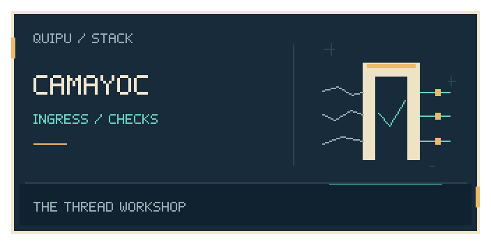

<p align="center"></p>

<p align="center">
  
</p>

# camayoc

**Camayoc gives AI coding agents a governed memory: a starter vocabulary for
work, decisions and outcomes, loaded into a [quipu](https://github.com/scbrown/quipu)
knowledge graph that refuses any record that does not say how it was learned
(observed, declared or inferred).** It is for teams whose agents keep
re-deciding things a past session already settled. It comes as a Claude Code
plugin (a skill, a session-start status hook and a bootstrap command), and as
plain scripts any agent that speaks HTTP can use.

The *quipucamayoc* was the Inca official who kept the quipus and certified what
was read back out of them.

<p align="center"></p>

This 20-second recording calls the existing adapter source API with two public synthetic CloudEvents. A deployment maps to DeploymentEvent; an unknown type is quarantined with exit 2. The documentation helper prints selected mapped fields without posting an episode or contacting Quipu. [Reproduce the recording](docs/demos/terminal.md).

## Why you would want it

- **Keep decisions between sessions:** give agents shared knowledge they can read back.
- **Check how a fact was learned:** admit records with explicit provenance.
- **Normalize event input:** map supported events and quarantine unknown types.

[The Camayoc book](https://intigraph.github.io/camayoc/) explains memory, vocabulary and ingress.

## Install

```sh
curl -fsSL https://raw.githubusercontent.com/intigraph/camayoc/main/install.sh | sh
```

Python 3.9+, curl, and a Linux or macOS shell. Downloads and verifies the latest source package into `~/.local/share/camayoc/TAG`.
No native executable, server or agent enrollment is installed.

The agent-memory CLI (`camayoc`, alias `cy`) installs separately with
`uv tool install git+https://github.com/intigraph/camayoc`; see the
[reference](docs/installation-reference.md#agent-memory-cli-camayoc-alias-cy).

Set `STACK_INSTALL_ROOT` on the receiving shell for another prefix.
Pinned releases, alternatives, configuration and removal are in the
[installation and usage reference](docs/installation-reference.md).

## First success in three commands

From an empty directory, bootstrap a governed memory and watch it prove its gate:

```bash
git clone -q --depth 1 https://github.com/intigraph/camayoc
QUIPU_SERVER=http://127.0.0.1:3030 bash camayoc/scripts/bootstrap.sh > bootstrap.log 2>&1
grep -E '^(ontology|shapes|gate: PROVEN — an untagged|camayoc:)' bootstrap.log
```

```text
ontology: loaded (core.ttl)
shapes: loaded (camayoc-core)
gate: PROVEN — an untagged Decision refused, as it must be.
camayoc: governed memory ready. Query first; record at the moment; tag honestly.
```

With no quipu on your machine, bootstrap downloaded one (sha256-checked),
started it, loaded the vocabulary and shapes, and then tried to write a
Decision with no provenance tag. The store refused it. That refusal is the
guarantee everything else rests on. Stop the server with
`kill "$(cat .quipu/server.pid)"`; the full log is in `bootstrap.log`.

## On your own data

Choose a vocabulary and profile before admitting records. The
[installation reference](docs/installation-reference.md) covers agent memory;
the [ingress design](docs/design/ingress.md) covers event normalization.
The terminal fixture maps a supported deployment event and refuses an unknown
type without posting either to a server.

## Wire it into your agent

Start with the [Camayoc skill](skills/camayoc/SKILL.md) and
[agent setup reference](docs/installation-reference.md). Configure the graph
endpoint and credentials through your deployment. Query existing knowledge
before adding facts; record provenance when writing. Installing source files
does not enroll an agent or activate a producer.

## Before you start

The source installer needs Python 3.9+, curl and a Linux or macOS shell.
The bootstrap example starts a local Quipu server and writes vocabulary and
shapes; run it in a disposable directory and stop its server afterward.
Agent-memory CLI installation is separate from the source package. Review
write rules and event coverage before connecting live producers.

## What's next

- [The Camayoc book](https://intigraph.github.io/camayoc/): concepts and setup.
- [Installation reference](docs/installation-reference.md): choose the required components.
- [Ingress design](docs/design/ingress.md): event mapping and quarantine.

### Related tools and repository knowledge

- [Tambo](https://github.com/intigraph/tambo): guided installation of the complete stack.
- [Detailed examples and agent setup](docs/installation-reference.md).

**Load this repository’s graph:** public repository-pendant assets have not yet been verified. When a release supplies the archive, checksum and provenance, follow the [verified import workflow](https://scbrown.github.io/quipu/sharing/index.html): extract the share directory and use `quipu import SHARE_DIR --db repository.db`. Import stages knowledge; ROOT stays unchanged.

<!-- delivery-catalog:start -->

## Delivery events

Bring deployment outcomes and change history into the same governed memory.
These adapters use CDEvents on CloudEvents and Camayoc's single ingress.

[Catalog data](https://github.com/intigraph/camayoc/blob/main/catalog/delivery-emitters.json) · [Updating the table](https://github.com/intigraph/camayoc/blob/main/catalog/README.md)

| Tool | Standard | How | Status | Docs |
| --- | --- | --- | --- | --- |
| GitHub / Forgejo Actions | CDEvents on CloudEvents | Reusable deployment-event action or CLI; skipped and cancelled jobs emit no deployment. | Supported adapter; activation is separate | [Guide](https://github.com/intigraph/camayoc/blob/main/actions/deployment-event/README.md) |
| Ansible | CDEvents on CloudEvents | Callback writes one event per applied host; failed or unreachable recap counters mean failure. | Supported adapter; activation is separate | [Guide](https://github.com/intigraph/camayoc/blob/main/emitters/ansible/README.md) |
| Terraform | CDEvents on CloudEvents | Wrap an actual apply -json; errors or a nonzero exit after an attempted change mean failure. | Supported adapter; activation is separate | [Guide](https://github.com/intigraph/camayoc/blob/main/emitters/terraform/README.md) |
| Native CDEvents | CDEvents on CloudEvents | Pass supported CDEvents through the single governed ingress; unknown types are quarantined. | Supported adapter; activation is separate | [Guide](https://github.com/intigraph/camayoc/blob/main/docs/design/ingress.md) |
| GitHub change lifecycle | CDEvents on CloudEvents | Read change, CI and native review records into ChangeEvent history; scheduling is separate. | Supported adapter; activation is separate | [Guide](https://github.com/intigraph/camayoc/blob/main/emitters/github/changes.py) |

The catalog describes source support, not installed producers or measured event coverage.
The graph queries for deployment frequency, change failure rate, lead time and restore time
need recorded events for the selected service, repository and time window.
Missing change or deployment history is not a measured zero.

<!-- catalog-source-sha256: ea2627bd96ba33263f3c3cc89dd0e64cfbb14788f6a14411df92448ec48aef14 -->
<!-- delivery-catalog:end -->

## 🧺 The stack

<!-- stack-table:start -->

The Quipu stack is built around a governed, bitemporal knowledge store: shared
facts, decisions and work history your agents can query. Quipu can check writes
against your rules, records where each fact came from, and answers what was true
when.

| tool | what it gives your agents |
|---|---|
| [tambo](https://github.com/intigraph/tambo) | 🧰 Agent Platform Toolkit - installs and configures the quipu stack |
| [quipu](https://github.com/scbrown/quipu) | stores shared facts with provenance and history; can check writes against your rules |
| [camayoc](https://github.com/scbrown/camayoc) | prepares knowledge and vocabulary for Quipu, with checks before it is admitted |
| [quechua](https://github.com/scbrown/quechua) | shared vocabulary and shapes for interoperable knowledge |
| [chaski](https://github.com/scbrown/chaski) | reacts to graph changes and delivers governed notifications |
| [bobbin](https://github.com/scbrown/bobbin) | indexes your codebase and injects context from that index and Quipu knowledge |
| [yupana](https://github.com/scbrown/yupana) | shows code impact and can read policies from Quipu to govern agent actions |
| [desire-path](https://github.com/scbrown/desire-path) | turns agent mistakes into feature requests; works on its own without Quipu |
| [seeds](https://github.com/scbrown/seeds) | a work item tracker backed by the Quipu knowledge base |
| [shantytown](https://github.com/scbrown/shantytown) | runs crews of AI agents on work items, triggered by hand, on a schedule or by events; can share work and memory through Quipu |
| [rikuy](https://github.com/scbrown/rikuy) | live brief: status, graphs, watches and signed decisions over Quipu |
| [shuttle](https://github.com/scbrown/shuttle) | runs signed agent workflows and keeps their records in Quipu |

<!-- stack-table:end -->

## Contributing

Run `just check` and `just test` before submitting changes.

## 📜 License

[License](LICENSE).
